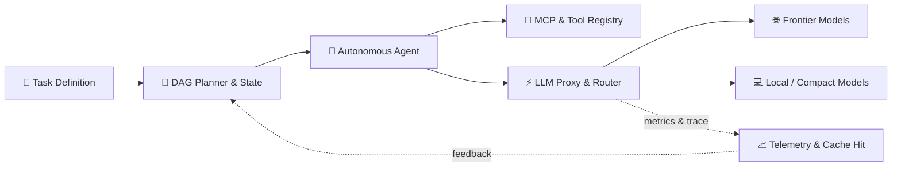

<div align="center">



<br/>

### I build the infrastructure and intelligence that make autonomous agents reliable, observable, and cost-aware.
<sub>🇧🇷 Engenheiro de Sistemas de IA · Agentes Autônomos · Gateways & Observabilidade de LLMs · Planejamento Complexo</sub>

<br/><br/>

[](https://rafaelmoreira.com.br)
[](https://www.linkedin.com/in/rrmlima)
[](https://github.com/rafaelmoreiraai)
[](mailto:contato@rafaelmoreira.com.br)

</div>

---

## ⚡ Core Focus & Architecture

| Area | What I Build & Research |
| :--- | :--- |
| **Autonomous Agent Systems** | Multi-agent coordination, deterministic execution harnesses, tool-calling routing, and self-healing loops (Hermes Agent, OpenCodex, Claude Code). |
| **LLM Gateways & Quota Control** | Multi-provider unified proxies, local credential bridging, fallbacks, token budgeting, and aggressive caching. |
| **LLM Observabilidade & Telemetry** | Real-time token telemetry, cache hit ratios, spend ledgers, and quota savings analytics across agent workloads. |
| **Planning & Industrial Systems** | Schedule analysis for capital projects: Primavera P6 (`.xer`), Earned Value Management (EVM), and DCMA 14-point health metrics. |

---

## 🛠️ Featured Open-Source Projects

<table>
  <tr>
    <td width="50%" valign="top">
      <h3>📊 <a href="https://github.com/rafaelmoreiraai/hermes-dag-monitor">hermes-dag-monitor</a></h3>
      <p><em>Visual token telemetry, cache hit rates, and quota savings dashboard for Hermes Agent & DAG-ULW pipelines.</em></p>
      <p>
        
      </p>
    </td>
    <td width="50%" valign="top">
      <h3>🏗️ <a href="https://github.com/rafaelmoreiraai/PlanSight">PlanSight</a></h3>
      <p><em>Local analysis engine for Primavera P6 <code>.xer</code> enterprise schedules, heuristic container, and EVM/DCMA compliance reporting.</em></p>
      <p>
        
      </p>
    </td>
  </tr>
  <tr>
    <td width="50%" valign="top">
      <h3>⚡ <a href="https://github.com/rafaelmoreiraai/opencodex">opencodex</a></h3>
      <p><em>Universal provider proxy for OpenAI Codex & Claude Code — multi-model routing, prompt caching, and quota guard.</em></p>
      <p>
        
      </p>
    </td>
    <td width="50%" valign="top">
      <h3>🧠 <a href="https://github.com/rafaelmoreiraai/deepclaude-installer">deepclaude-installer</a></h3>
      <p><em>Claude Code harness backed by DeepSeek V4 Pro with CLI fallback, DuckDuckGo MCP tooling, and low-cost reasoning orchestration.</em></p>
      <p>
        
      </p>
    </td>
  </tr>
  <tr>
    <td width="50%" valign="top">
      <h3>🔌 <a href="https://github.com/rafaelmoreiraai/hermes-commandcode">hermes-commandcode</a></h3>
      <p><em>Command Code provider plugin for Hermes Agent — credential import, catalog discovery, and token-managed transport.</em></p>
      <p>
        
      </p>
    </td>
    <td width="50%" valign="top">
      <h3>🤖 <a href="https://github.com/rafaelmoreiraai/customer-agent-installer">customer-agent-installer</a></h3>
      <p><em>Guided bootstrap for deploying and onboarding autonomous customer-service agents into production environments.</em></p>
      <p>
        
      </p>
    </td>
  </tr>
</table>

---

## 📐 How I Design Agent Infrastructure



> *"Every agent call must be traceable, every token accounted for, and every plan inspectable."*

---

## 💻 Tech Stack & Tooling

```
Languages       Python · TypeScript · SQL · Shell / Bash · Go
AI & Agents     Hermes Agent · OpenCodex · Claude Code · MCP (Model Context Protocol) · Function Calling
Architecture    DAG Orchestration · Prompt Caching · LLM Gateways · Token Economics · Telemetry
Infra & Ops     Docker · Linux (Debian/Ubuntu) · Cloudflare · HestiaCP · Tailscale Mesh
Domain Eng      Primavera P6 (.xer parser) · Earned Value Management (EVM) · DCMA 14-Point
```

---

<div align="center">
<sub>Built with precision · <a href="https://rafaelmoreira.com.br">Rafael Moreira Lima</a> · São Paulo, Brasil</sub>
</div>
